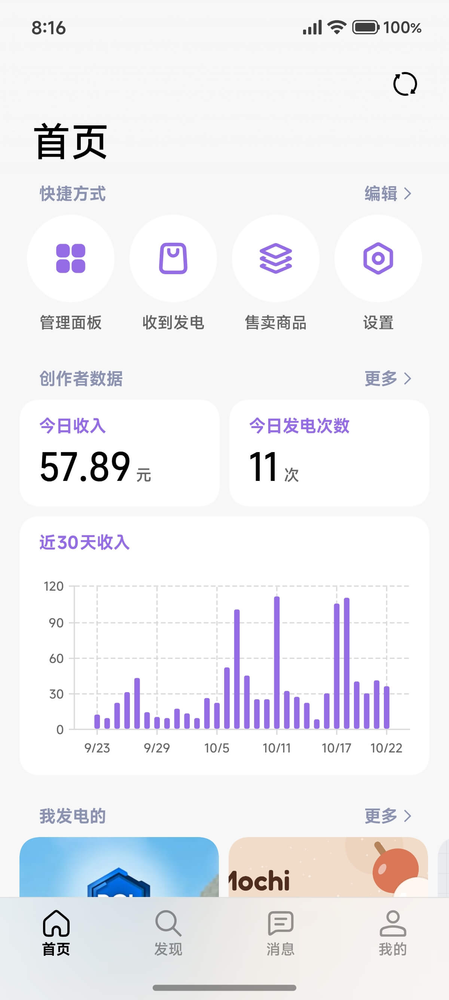
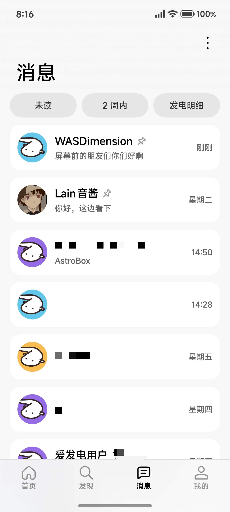
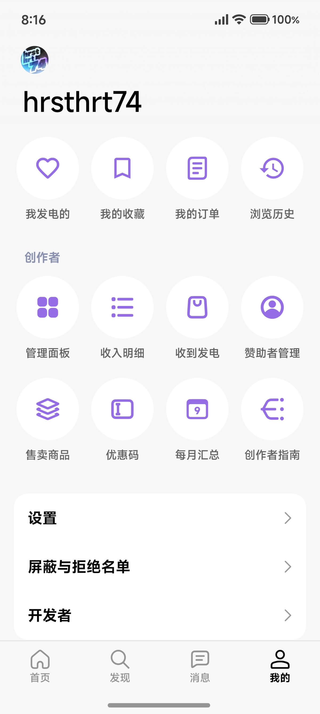

<div align="center">

<!-- 顶部品牌横幅 -->


# 爱发电第三方客户端

基于 **Kotlin + Jetpack Compose + [Miuix](https://github.com/YuKongGame/Miuix)** 构建的爱发电（afdian.com）第三方客户端。

> ⚠️ **功能尚未全部完成**，已实现范围与已知限制见 [「已知限制」](#十已知限制) 

</div>

---

## 一、免责声明

> [!IMPORTANT]
> > **本项目是爱发电的第三方非官方客户端，与爱发电（afdian.com）及其运营方不存在任何隶属、授权或背书关系。**
> 
> > **本项目不包含下单、支付、购物车、提现等涉及交易的功能。此限制为设计如此，请勿反馈。交易相关会引导到官方网页/客户端继续操作。**

> [!WARNING]
> **本应用为爱发电的第三方客户端，有问题请勿向爱发电官方反馈。**
>
> 爱发电官方客服与反馈渠道只受理官方客户端与网站的问题。本应用的 bug、功能建议、账号异常请提到本项目的 [GitHub Issues](https://github.com/hrsthrt74/afdian-compose/issues)，反馈时附上「设置 → 关于」页底部的版本号与构建类型。

- 「爱发电」「afdian」「Afdian」等名称与标识归其各自权利人所有，本项目不主张任何商标权。
- 本应用调用的是爱发电**网页端使用的接口**，并非官方开放 API。接口随时可能变更或失效，届时本应用的相关功能会不可用。
- 本项目按「现状提供」原则维护，不承诺任何 SLA、不承诺与官方客户端的功能一致。
- **使用本应用即表示你已知悉上述风险，并自行承担使用后果**；因接口变更、账号策略调整等原因造成的账号异常，本项目不承担责任。

---

## 二、界面预览

<table align="center">
  <tr>
    <td align="center" width="25%"><a href="docs/images/home.jpg"></a></td>
    <td align="center" width="25%"><a href="docs/images/discover.jpg"></a></td>
    <td align="center" width="25%"><a href="docs/images/messages.jpg"></a></td>
    <td align="center" width="25%"><a href="docs/images/profile.jpg"></a></td>
  </tr>
  <tr>
    <td align="center"><b>首页</b><br>可自定义布局</td>
    <td align="center"><b>发现</b><br>动态、创作者搜索</td>
    <td align="center"><b>消息</b><br>会话列表、筛选 Chip、高级功能</td>
    <td align="center"><b>我的</b><br>收藏 / 历史 / 创作者后台</td>
  </tr>
</table>


---

## 三、功能一览

| 模块    | 能力                                                          |
|-------|-------------------------------------------------------------|
| 登录    | 密码 / 验证码双通道、图形验证码、【独有】**多账号切换**                             |
| 首页    | 【独有】**可自定义模块**：**数据卡（收入 / 提现 / 发电人数等）**、**可拖拽排序布局**等        |
| 图表    | 【独有】**收入趋势环形图与折线图，支持窄体可变字体与数字滚动动画**                         |
| 发现    | 动态流、创作者搜索、搜索历史、动态详情                                         |
| 创作者主页 | 目标、方案、商品、赞助榜、合集、动态列表                                        |
| 创作者后台 | 【独有】**可自定义数据卡**、收入明细、每月汇总、收到发电、赞助者管理、感谢页、订单、售卖商品、优惠码、FAQ 设置 |
| 消息    | 【独有】**置顶**、【独有】**一键已读**、【独有】**文本消息卡片解析**、FAQ 快捷回复           |
| 我的    | 收藏、发电的、【独有】**浏览历史**、屏蔽与拒绝名单、开发者页                            |
| 系统    | 【独有】**主题色 / Monet 配色、模糊开关、底栏样式、手势返回、预测性返回**                 |
| 工具    | 【独有】**存储空间管理**、日志管理与导出、接口调试                                 |
| 其他    | i18n 待做（当前仅简体中文）                                            |

> 【独有】指的是：与官方客户端相比独有的功能。

---

## 四、变体

只有一个构建维度 `edition`，配合两个构建类型，共 4 个变体：

| 变体                | applicationId                 | minSdk | 用途                                |
|-------------------|-------------------------------|--------|-----------------------------------|
| `standardDebug`   | `com.hrsthrt74.afdian`        | 34     | 完整版调试包                            |
| `standardRelease` | `com.hrsthrt74.afdian`        | 34     | **完整版**：模糊、预测性返回全开，日常使用选它         |
| `legacyDebug`     | `com.hrsthrt74.afdian.legacy` | 29     | 低配兼容版调试包                          |
| `legacyRelease`   | `com.hrsthrt74.afdian.legacy` | 29     | 低配兼容版：仅供 Android 10~13 旧设备        |

- `legacy` 通过 `applicationIdSuffix = ".legacy"` 与完整版**并存安装**，登录态与缓存天然隔离。

---

## 五、从源码构建

### 环境要求

| 组件                     | 版本                                                          |
|------------------------|-------------------------------------------------------------|
| JDK                    | **21**（`sourceCompatibility` / `targetCompatibility` 均为 21） |
| Android Gradle Plugin  | 9.4.1                                                       |
| Gradle                 | 9.7.1（由 wrapper 自动下载）                                       |
| Kotlin                 | 2.4.20                                                      |
| compileSdk / targetSdk | 37 / 36                                                     |
| minSdk                 | 34（legacy flavor 29）                                        |

### 验证命令

变体名只有 edition 一段，任务名直接写 `standardDebug` / `legacyDebug`：

```bash
./gradlew :app:testStandardDebugUnitTest
./gradlew :app:testLegacyDebugUnitTest
./gradlew :app:assembleStandardDebug
./gradlew :app:assembleLegacyDebug
```

`assembleDebug` / `assembleRelease` / `test` 是**聚合任务**，会把两个 edition 一起跑；
但变体专属任务不能省掉 edition 那一段——`testDebugUnitTest` 会直接报 `Ambiguous matches`。

两个 edition 都要打包：legacy 的 minSdk 与模糊开关不同，只编 standard 会漏掉低配分支。

构建已开启 Gradle **配置缓存**与**构建缓存**（见 `gradle.properties`），增量构建约 2 秒。
副作用：配置阶段取的时间戳（崩溃报告里的 `Build Time`）会被冻结在「配置缓存条目创建时」，
改动 `build.gradle.kts` / 依赖版本 / `gradle.properties` 后才会刷新。
需要绝对准确的构建时间时，临时加 `--no-configuration-cache` 跑一次即可。

---

## 六、签名配置

release 签名信息从仓库根目录的 `key.properties` 读取（**该文件已在 `.gitignore` 中，不会被提交**）：

```properties
storeFile=afdian-hrsthrt74.jks
storePassword=你的密钥库密码
keyAlias=你的密钥别名
keyPassword=你的密钥密码
```

- `storeFile` 是**相对仓库根目录**解析的路径。
- 四个键缺任意一个，构建照常进行，但 release 产物**未签名、不可直接安装分发**（构建脚本会打印一条 warn 提示）。
- 贡献者请自备 keystore：`keytool -genkey -v -keystore my.keystore -alias myalias -keyalg RSA -keysize 2048 -validity 10000`，
  并把 `my.keystore` 放到仓库根目录、在 `key.properties` 里指向它。
- `*.jks` / `*.keystore` / `key.properties` / `local.properties` 均已在 `.gitignore` 中，**请不要**用 `git add -f` 强行提交。

### 版本号与发布流程

- `versionCode` 规则：`major * 10000 + minor * 100 + patch`。
- `versionName` 使用语义化版本（当前 `1.0.0`）。
- 唯一来源：`app/build.gradle.kts` 的 `defaultConfig`。CI 支持 `-PversionName` / `-PversionCode`
  覆盖，但 release 工作流会先校验 tag 与脚本里的 `versionName` 一致才继续。

发版只需两步：

1. 改 `app/build.gradle.kts` 的 `versionCode` / `versionName`，提交到 master；
2. 打 tag 并推送：`git tag v1.2.3 && git push origin v1.2.3`。

`.github/workflows/release.yml` 会自动打两个 edition 的签名包、校验签名，并以 `v1.2.3`
创建 Release。**不要手工上传 APK**：手工改名漏一次，用户就挑不到包。

APK 文件名由 Gradle 直接产出成 `Afdian-<版本>-<edition>-<buildType>.apk`
（如 `Afdian-1.2.3-standard-release.apk`），与应用内 `pickApkAsset` 的挑选规则一致：

```
Afdian-1.2.3-standard-release.apk
Afdian-1.2.3-legacy-release.apk
```

### CI 与 Secrets

| 文件 | 触发 | 产出 |
|---|---|---|
| `.github/workflows/build.yml` | push/PR 到 master、手动 | 两个 edition 的 debug 包；**push 到 master** 时额外产出签名 release 包（「Actions 构建」更新通道的数据源） |
| `.github/workflows/release.yml` | 推 `v*` tag、手动指定 tag | 两个签名 APK + GitHub Release（非 draft、非 prerelease） |

Actions 包要能用正式签名覆盖安装，需要在本仓库配置四个 Secrets：

| Secret | 内容 |
|---|---|
| `ANDROID_KEYSTORE_BASE64` | `.jks` 的 base64（不带换行） |
| `ANDROID_KEYSTORE_PASSWORD` | storePassword |
| `ANDROID_KEY_ALIAS` | keyAlias |
| `ANDROID_KEY_PASSWORD` | keyPassword |

Windows 生成 base64：

```powershell
[Convert]::ToBase64String([IO.File]::ReadAllBytes("C:\path\afdian-hrsthrt74.jks")) | Set-Clipboard
```

两个工作流在缺 Secret 时**直接失败**，而不是产出一个装不上的未签名包。

⚠️ `build.yml` 的文件名是应用侧常量（`GithubReleaseService.WORKFLOW_FILE`）。
改名会让该 workflow 的 `run_number` 从 1 重新计数，已装 Actions 包的用户会认为「没有更新」。

签名一致性：Actions 包与 Release 包同签名，可互相覆盖、保留登录态；
本地 Android Studio 的 debug 包是另一套签名，与两者都不能互相覆盖安装。

### 构建参数（CI 用）

| 参数 | 作用 |
|---|---|
| `-PversionName` / `-PversionCode` | 覆盖版本号（release 工作流从 tag 推导并校验） |
| `-PbuildNumber` | GitHub `run_number`；0 表示非 Actions 构建 |
| `-PbuildChannel` | `local` / `actions` / `stable`，仅用于展示与排查 |
| `-PgitSha` | 短 commit，展示在「设置 → 关于」页脚 |

本地不传任何参数，行为与改造前一致（`1.0.0 (10000)`、`BUILD_NUMBER=0`）。

---

## 七、legacy 低配兼容版

`legacy` 是给 Android 10-13（API 29-33）旧设备准备的兜底版本：

- `minSdk` 降到 29；
- 关闭全部模糊效果与系统预测性返回；

**装错包会被拦截**：legacy 包被装在 API ≥ 34 的设备上时，`EditionGuard` 会在启动阶段直接阻断并提示换装完整版。
这是预期行为，不是崩溃。完整版 `standardRelease` 在所有 API ≥ 34 的设备上都可用。

---

## 八、隐私与数据

- 所有数据（登录凭据、设置、浏览历史、搜索历史、缓存）**只存在本机**，应用内没有账号注册、没有额外的追踪。
- 登录凭据经 **AndroidKeyStore + AES/GCM** 加密后落盘，与设备绑定；DataStore 已排除在系统云备份与设备迁移之外。
- **没有任何埋点、崩溃统计或行为分析 SDK**；崩溃报告只写本地文件，可手动导出。
- 运行日志与崩溃报告在落盘与导出前都会做**脱敏**（`auth_token`、`Cookie`、`token` 字段被替换为 `***`）。
- 唯一会离开设备的数据是你主动发起的网络请求 —— 本应用只请求爱发电域名，以及用于检查更新的 GitHub API
  （`api.github.com`：正式版通道读最新 Release，Actions 通道读 `build.yml` 最近一次成功的运行）。
- 应用内更新只从 GitHub Releases 的正式附件下载安装包，落盘后先校验**包名与 versionCode**
  再交给系统安装器，不会安装来源不明的 APK。

---

## 九、接口风险提示

本应用使用的是爱发电**网页端内部接口**（`/api/...` 路径），没有官方文档、没有稳定性承诺：

- 接口路径、参数、返回结构随时可能变化；
- 平台若加强风控（验证码、频控、设备指纹），部分功能可能不可用；
- 使用方式请自行判断风险，账号安全由你自己负责；
- 登录凭据只用于向爱发电发起请求，本项目不向任何第三方转发。

若某个功能突然失效，大概率是上游接口变了，而不是 App 出了 bug —— 欢迎提 issue 反馈。

---

## 十、已知限制

部分功能**尚未完成**，请参阅应用内【设置 → 关于 → 功能完成度】页了解详情。

另外：

- 界面文案**仅简体中文**，i18n 未做。
- 不包含下单、支付、购物车、提现等涉及交易的功能。此限制为设计如此，**请勿反馈**。交易相关会引导到官方网页/客户端继续操作。

---

## 十一、项目结构与开发文档

```
afdian/
├── app/                        # 单一 app 模块
│   └── src/main/java/com/hrsthrt74/afdian/
│       ├── data/               # 网络、鉴权、缓存、设置、日志、统计、更新
│       ├── ui/                 # Compose 界面（screens / components / navigation / theme）
│       ├── util/               # 通用工具
│       ├── AppLog.kt           # 全局日志门面（禁止直接用 android.util.Log）
│       ├── CrashHandler.kt     # 本地崩溃报告
│       ├── EditionGuard.kt     # legacy 装错包拦截
│       └── AfdianApplication.kt # 进程级初始化（日志落盘、崩溃兜底）
├── gradle/libs.versions.toml   # 依赖与插件版本
├── docs/images/                # README 用图（横幅与界面截图）
├── DESIGN.md                   # UI 规范（卡片、弹层、滚动条、状态管理）
├── AGENTS.md                   # AI 协作与代码风格约定
├── CONTEXT*.md                 # 开发过程文档：架构 / 功能清单 / 缺口分析 / 路线图
└── LICENSE                     # Apache-2.0
```

`CONTEXT*.md` 与 `AGENTS.md` 是**开发过程记录**，部分描述可能滞后于当前实现，以代码为准。

---

## 十二、致谢

- [Miuix](https://github.com/YuKongGame/Miuix) —— HyperOS 风格的设计语言与组件库
- [Coil](https://github.com/coil-kt/coil) —— 图片加载
- [Vico](https://github.com/patrykandpatrick/vico) —— Compose 图表
- [Telephoto](https://github.com/saket/telephoto) —— 全屏图片查看器的缩放与子采样
- [AboutLibraries](https://github.com/mikepenz/AboutLibraries) —— 依赖与许可证清单
- [Reorderable](https://github.com/sh.calvin.reorderable) —— 拖拽排序
- [OkHttp](https://github.com/square/okhttp) / [Jsoup](https://github.com/jsoup/jsoup) —— 网络与 HTML 解析
- [kotlinx.serialization](https://github.com/Kotlin/kotlinx.serialization) —— JSON 解析（检查更新）

---

## 十三、License

本项目源码采用 [Apache License 2.0](LICENSE)。
